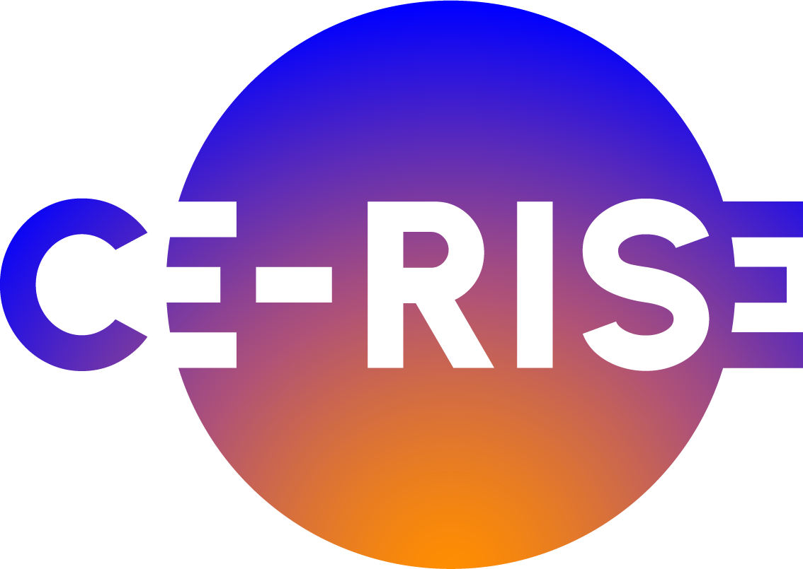

# CE-RISE SEE Impacts Calculation Service

A service for calculating the environmental footprints of product systems from CE-RISE
Product System and LCI Dataset records. It uses Brightway with the BONSAI background and fixed
Environmental Footprint (EF) 3.1 characterization factors, returning results as validated
CE-RISE Integrated LCA data objects with the functional unit, assessment methods, and calculation
provenance.

SEE stands for socio-economic and environmental impacts; the current calculation
endpoint covers the environmental dimension.

The [CE-RISE Solution portal](https://solution.ce-rise.eu/) is the main entry point for human
users exploring the wider solution and its components.

## Request and Result

One `POST /compute` request contains:

1. `model_versions` for Product System, LCI Dataset, and Integrated LCA validation in HEX Core;
2. one `product_system` record selecting the foreground activities and reference flow;
3. the referenced `lci_datasets` with activities and inventory flows;
4. a `functional_unit` naming that reference flow, its unit, and the requested quantity.

The service validates the records, resolves foreground and background links, calculates the
inventory once, and applies all 25 configured EF3.1 methods. It validates and returns one
Integrated LCA object containing every indicator's score, unit, method, and factor-set reference,
together with the functional unit, input references, and available data and
software provenance. A singular calculation returns a `not_calculable` diagnostic instead of a
score. Nonconforming records or unresolved links return `422`.

The [Compute Workflow](api-overview.md) explains the record relationships and gives a runnable
PV request using the bundled BONSAI background. The [API Reference](api-reference.md) defines
the endpoint responses and errors.

## Start Using It

Prepare the background and start the service from source using [Local Testing](local-testing.md),
or follow [Deployment](deployment.md) for the image. Configure a reachable HEX Core with the
requested model versions, then inspect `GET /capabilities` and `GET /methods` for the configured
background and methods. Send the four-field JSON request to `POST /compute`.

The [HEX Core integration](integration.md) page covers the validation dependency.
[Architecture](architecture.md) describes the internal calculation, and
[Service Scope](scope.md) explains the assessment boundary.

Funded by the European Union under Grant Agreement No. 101092281 — CE-RISE.  
Views and opinions expressed are those of the author(s) only and do not necessarily reflect those of the European Union or the granting authority (HADEA).
Neither the European Union nor the granting authority can be held responsible for them.

© 2026 CE-RISE consortium.  
Service source licensed under the [European Union Public Licence v1.2 (EUPL-1.2)](https://joinup.ec.europa.eu/collection/eupl/eupl-text-eupl-12).

Attribution: CE-RISE project (Grant Agreement No. 101092281) and the individual authors/partners as indicated.

Developed by NILU (Riccardo Boero - ribo@nilu.no), Leiden University (Mintjes, B.A. (Berend) - b.a.mintjes@cml.leidenuniv.nl; Stefano Merciai - s.merciai@cml.leidenuniv.nl), and Empa (Francesco Barilli - francesco.barilli@empa.ch; Roland Hischier - roland.hischier@empa.ch) within the CE-RISE project.
